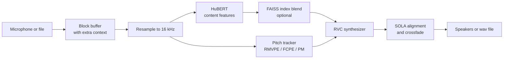

<div align="center">


# Overtone

**Real-time voice conversion for RVC models, from the command line or a desktop app.**

Speak into your microphone and hear the converted voice live, or batch-convert audio files with the same streaming pipeline.

[](LICENSE)


[Features](#features) ·
[Quick start](#quick-start) ·
[Usage](#usage) ·
[Desktop app](#desktop-app) ·
[How it works](#how-it-works) ·
[Development](#development)

</div>

---

## Table of contents

- [Features](#features)
- [Requirements](#requirements)
- [Quick start](#quick-start)
  - [1. Create a virtual environment](#1-create-a-virtual-environment)
  - [2. Install dependencies](#2-install-dependencies)
  - [3. Download the base models](#3-download-the-base-models)
  - [4. Add voice models](#4-add-voice-models)
- [Usage](#usage)
  - [Live microphone conversion](#live-microphone-conversion)
  - [File conversion](#file-conversion)
  - [Choosing audio devices](#choosing-audio-devices)
  - [Common options](#common-options)
- [Desktop app](#desktop-app)
- [How it works](#how-it-works)
- [Project structure](#project-structure)
- [Configuration](#configuration)
- [Development](#development)
- [Troubleshooting](#troubleshooting)
- [Responsible use](#responsible-use)
- [Acknowledgements](#acknowledgements)
- [License](#license)

## Features

- **Low-latency live conversion.** Microphone audio is processed in fixed-size blocks and stitched together with a SOLA crossfade, so the output stays continuous with no clicks at block edges.
- **Offline file conversion.** Convert `.wav`, `.flac` or `.ogg` files through the exact same block pipeline used live, so what you hear live is what you get on disk.
- **Three pitch trackers.** RMVPE (default, most accurate), FCPE (lighter on the GPU) and Praat PM (classic), selectable per session.
- **Pitch and formant shifting.** Shift up to ±24 semitones and adjust formant independently to brighten or darken the timbre.
- **FAISS index retrieval.** Optionally blend the output toward a voice's `.index` file for closer timbre matching.
- **Automatic hardware selection.** Picks the best CUDA GPU and precision (float16 on modern cards, float32 on Pascal and GTX 16-series). Falls back to DirectML, then CPU.
- **CUDA graph acceleration.** Fixed-shape GPU work (HuBERT, pitch, synthesizer) is recorded once and replayed on later blocks to cut kernel launch overhead.
- **Flexible audio I/O.** Pick devices by index or name, filter by host API, and use WASAPI exclusive mode for the lowest latency on Windows.
- **Desktop app.** An Electron + React interface with:
  - **Live:** model, index, device and pitch controls with a streaming process log.
  - **Presets:** saved voice profiles with artwork, quick switching and last-used tracking.
  - **SFX:** a soundboard with per-pad keybinds and volume, a master volume, and optional routing to a second output device (for example a virtual cable into Discord or OBS).
- **One source of truth for settings.** Every option is defined once in [`desktop/shared/opts-spec.json`](desktop/shared/opts-spec.json) and shared by the Python CLI, the Electron main process and the React UI.

## Requirements

| Component | Version                                                                                   |
| --------- | ----------------------------------------------------------------------------------------- |
| OS        | Windows 10/11 x64 (the CLI also runs on Linux; the desktop app is Windows only)           |
| Python    | 3.12 x64                                                                                  |
| GPU       | NVIDIA GPU with at least 4 GB VRAM and compute capability 5.3 or higher (recommended)     |
| CUDA      | 12.8 wheels for PyTorch (required for RTX 50 series)                                      |
| Node.js   | 22.12 or newer (only needed to build or develop the desktop app)                          |

> [!NOTE]
> Without a supported NVIDIA GPU, Overtone falls back to DirectML (if `torch-directml` is installed) and then to the CPU. CPU inference works for file conversion but is usually too slow for live use.

## Quick start

### 1. Create a virtual environment

Run this from the repository root (Windows PowerShell):

```powershell
python -m venv .venv
.venv\Scripts\activate
```

> [!IMPORTANT]
> The desktop app looks for the interpreter at `.venv\Scripts\python.exe`, so keep the virtual environment at that path.

### 2. Install dependencies

PyTorch is installed separately so `requirements.txt` cannot replace the CUDA build:

```powershell
python -m pip install torch==2.7.1+cu128 torchaudio==2.7.1+cu128 --index-url https://download.pytorch.org/whl/cu128 --extra-index-url https://pypi.org/simple
python -m pip install -r requirements.txt
```

For a different CUDA version or hardware, pick the matching command from [pytorch.org](https://pytorch.org/get-started/locally/).

### 3. Download the base models

HuBERT (content features) and RMVPE (pitch) are required for every conversion:

```powershell
python -m pip install --upgrade huggingface_hub
hf download lj1995/VoiceConversionWebUI --revision main --include "hubert_base/*" --local-dir assets
hf download lj1995/VoiceConversionWebUI rmvpe.pt --revision main --local-dir assets/rmvpe
```

### 4. Add voice models

Place trained RVC voice models and their optional retrieval indexes here:

```
assets/
├── hubert_base/     # downloaded in step 3
├── rmvpe/rmvpe.pt   # downloaded in step 3
├── weights/         # your .pth voice models
├── indices/         # matching .index files (optional)
└── sounds/          # soundboard clips for the desktop app (optional)
```

The `assets/` folder is git-ignored, so models never end up in version control.

## Usage

The CLI entry point is `inference.realtime`. Run `python -m inference.realtime --help` for the full list of options.

### Live microphone conversion

```powershell
python -m inference.realtime --model assets/weights/myvoice.pth --index assets/indices/myvoice.index --live
```

This plays your converted voice through the default speakers. Press `Ctrl+C` to stop.

### File conversion

Leave out `--live` and pass `--input` and `--output` instead:

```powershell
python -m inference.realtime --model assets/weights/myvoice.pth --index assets/indices/myvoice.index --input voice.wav --output converted.wav
```

Use `--subtype` to choose the output format: `FLOAT` (default), `PCM_16`, `PCM_24` or `PCM_32`.

### Choosing audio devices

List every input and output device PortAudio can see:

```powershell
python -m inference.realtime --list-devices
```

Add `--json` for machine-readable output. This is what the desktop app uses.

Then select devices by index or by part of their name:

```powershell
python -m inference.realtime --model assets/weights/myvoice.pth --live --input-device "Microphone" --output-device "CABLE Input" --host-api WASAPI
```

### Common options

| Flag                                   | Default | Description                                                                 |
| -------------------------------------- | ------- | --------------------------------------------------------------------------- |
| `--model`                              | —       | Path to a trained `.pth` voice model (required)                             |
| `--index`                              | —       | Optional `.index` retrieval file                                            |
| `--index-rate`                         | `0.75`  | How strongly to blend toward the index (0–1)                                |
| `--key`                                | `0`     | Pitch shift in semitones (−24 to 24)                                        |
| `--formant`                            | `0`     | Formant shift in semitones                                                  |
| `--f0`                                 | `rmvpe` | Pitch tracker: `rmvpe`, `fcpe` or `pm`                                      |
| `--f0-min` / `--f0-max`                | `50` / `1100` | Pitch range treated as voiced, in Hz                                  |
| `--rms-mix-rate`                       | `0`     | `0` follows your loudness, `1` keeps the model's loudness                   |
| `--input-gain` / `--output-gain`       | `1`     | Gain applied before and after conversion                                    |
| `--block-time`                         | `0.25`  | Block length in seconds. Lower means less latency but more GPU load.        |
| `--crossfade-time`                     | `0.05`  | SOLA crossfade length in seconds                                            |
| `--extra-time`                         | `2.5`   | Context in seconds fed to the model ahead of each block                     |
| `--input-device` / `--output-device`   | default | Device index or part of its name                                            |
| `--host-api`                           | any     | Only consider devices on this host API (for example `WASAPI`)               |
| `--latency`                            | auto    | `low`, `high` or a number of seconds                                        |
| `--wasapi-exclusive`                   | off     | Open WASAPI devices in exclusive mode                                       |

## Desktop app

The desktop app runs the same converter as `inference.realtime --live` and exposes every option through a graphical interface. It drives the Python environment you set up in the [quick start](#quick-start); it does not install Python or download models for you.

### Run from source

```powershell
cd desktop
npm install
npm start
```

`desktop` is an npm workspace, so one `npm install` installs both the Electron shell and the React renderer. `npm start` rebuilds the renderer only when its sources have changed since the last build. Delete `renderer\dist` to force a rebuild.

### Build a portable executable

```powershell
cd desktop
npm install
npm run pack
```

This runs the full verification suite, builds the renderer and produces `desktop\dist\Overtone.exe`.

> [!IMPORTANT]
> Keep `Overtone.exe` inside the project folder (for example in `desktop\dist`). On launch it searches upward for the folder that contains both `.venv\Scripts\python.exe` and `inference\realtime.py`.

Models in `assets\weights` and indexes in `assets\indices` appear in the app automatically, and you can browse to files stored anywhere else.

## How it works



1. **Buffering.** Incoming audio is cut into fixed blocks (`--block-time`), each prefixed with a few seconds of earlier audio (`--extra-time`) so the model has context.
2. **Content.** HuBERT turns the 16 kHz audio into features that describe *what* was said, independent of who said it.
3. **Retrieval.** When an index is provided, those features are pulled toward the nearest neighbours from the target voice's training data.
4. **Pitch.** The selected tracker estimates the fundamental frequency, which is shifted by `--key`.
5. **Synthesis.** The RVC synthesizer combines content and pitch into audio in the target voice.
6. **Stitching.** SOLA slides each new block until it best matches the end of the previous one, then crossfades the two to avoid audible seams.

Before the audio stream opens, the converter runs two silent warm-up blocks. This loads the pitch model and records the CUDA graphs, so the first real blocks don't drop out.

In the desktop app, the Electron main process spawns this pipeline as a Python child process and streams its log back to the window over IPC. The status lamp shows **Starting…** while the model loads and warms up, and switches to **Live** once Python reports that audio is flowing. Pressing Stop ends the process.

## Project structure

```
.
├── inference/                 Python inference package
│   ├── realtime.py            CLI entry point: mic capture, file conversion, device listing
│   ├── converter.py           block buffering, warm-up and SOLA crossfade
│   ├── rtrvc.py               streaming RVC model (HuBERT, index, pitch cache, synthesizer)
│   ├── device.py              GPU and precision selection
│   ├── cuda_graph.py          CUDA graph capture and replay
│   ├── opts.py                loads the shared option spec
│   ├── hubert.py              HuBERT content features
│   ├── rmvpe.py               RMVPE pitch estimation
│   ├── fcpe.py                FCPE pitch estimation (DirectML-compatible)
│   └── module/                synthesizer network, ported from upstream RVC
├── desktop/                   Electron desktop app
│   ├── main.js                app lifecycle and window
│   ├── preload.js             the only API exposed to the page
│   ├── args.js                builds CLI arguments for inference.realtime
│   ├── repo.js                locates the project folder from the exe
│   ├── main/                  project locator, Python process control, IPC handlers
│   ├── shared/opts-spec.json  single source of truth for every option
│   ├── tests/                 main-process tests
│   └── renderer/              React + TypeScript UI (Vite)
│       └── src/
│           ├── components/    one .tsx and one .module.css per component
│           ├── hooks/         useLog, useDevices, useDismiss
│           ├── lib/           bridge types, option specs, presets, sanitizing
│           ├── pages/         Live, Presets and SFX pages
│           └── styles/        global tokens and shared control styles
├── requirements.txt
└── LICENSE
```

## Configuration

| Environment variable       | Purpose                                                                          |
| -------------------------- | -------------------------------------------------------------------------------- |
| `RVC_CUDA_GRAPH`           | Set to `0` to turn off CUDA graph replay (on by default when supported).         |
| `RVC_CUDA_GRAPH_MAX_CACHE` | Maximum number of recorded graph shapes to keep per model (default `8`).         |
| `RVC_PYTHON`               | Path to the Python interpreter the desktop app should use instead of `.venv`.    |
| `VITE_DEV_SERVER_URL`      | Makes Electron load the renderer from a Vite dev server for hot reload.          |

## Development

All desktop scripts run from the `desktop` folder.

| Script                              | What it does                                                                         |
| ----------------------------------- | ------------------------------------------------------------------------------------ |
| `npm run verify`                    | Runs `format:check`, `lint`, `typecheck` and `test`. Run this before committing.     |
| `npm test`                          | Vitest across the Electron main process, the shared option spec and the renderer.    |
| `npm run lint`                      | ESLint with zero warnings allowed.                                                   |
| `npm run format` / `format:check`   | Prettier.                                                                            |
| `npm run typecheck`                 | `tsc --noEmit` over the renderer.                                                    |
| `npm run dev`                       | Vite dev server for the renderer, with hot reload.                                   |
| `npm start`                         | Launches Electron.                                                                   |
| `npm run pack`                      | `verify`, then the renderer build, then `electron-builder` into `desktop\dist`.      |

### Front-end development with live reload

Run the Vite dev server and point Electron at it, each in its own terminal:

```powershell
cd desktop
npm run dev
```

```powershell
cd desktop
$env:VITE_DEV_SERVER_URL="http://localhost:5173"; npm start
```

### Adding an inference option

Every option is described once in [`desktop/shared/opts-spec.json`](desktop/shared/opts-spec.json): its flag, type, default, range, UI label, tooltip and CLI help text. That file feeds `inference/realtime.py`'s argument parser, `desktop/args.js` and the renderer's form controls.

1. Add the option to `opts-spec.json`. It appears in `python -m inference.realtime --help` and in the app's **More settings** sheet.
2. Add its type to `InferenceOpts` in [`desktop/renderer/src/lib/bridge.ts`](desktop/renderer/src/lib/bridge.ts).
3. Read it in the Python code where it is needed.

### Styling conventions

- [`renderer/src/styles/global.css`](desktop/renderer/src/styles/global.css) holds only what has no owning component: the reset, the design tokens in `:root` and element defaults.
- [`renderer/src/styles/controls.module.css`](desktop/renderer/src/styles/controls.module.css) holds the shared look of plain inputs and selects.
- Everything else lives in the CSS module next to its component.

## Troubleshooting

<details>
<summary><b>The desktop app says it could not find the project</b></summary>

`Overtone.exe` must sit somewhere inside the project folder, no more than eight levels deep, and the project must contain `.venv\Scripts\python.exe`. Alternatively, set `RVC_PYTHON` to your interpreter's path.
</details>

<details>
<summary><b>Live audio crackles or drops out</b></summary>

Increase `--block-time` (for example to `0.35`), switch to the lighter `fcpe` pitch tracker, or try `--latency high`. Check the log to confirm inference is running on your GPU and not the CPU.
</details>

<details>
<summary><b>"Several devices match" or "No device matches"</b></summary>

Run `--list-devices` and pass the device's numeric index, or add `--host-api` to narrow the search (the same device often appears once per host API).
</details>

<details>
<summary><b>The converted voice sounds robotic or off-pitch</b></summary>

Adjust `--key` so the pitch suits the target voice (for example +12 for a male-to-female conversion), raise `--rmvpe-threshold` to ignore background noise, or tune `--index-rate`.
</details>

## Responsible use

Voice conversion can imitate real people. Only use voice models you have the right to use, get consent before converting someone else's voice, and never use this project to impersonate, deceive or harass anyone.

## Acknowledgements

- [Retrieval-based-Voice-Conversion-WebUI](https://github.com/RVC-Project/Retrieval-based-Voice-Conversion-WebUI): the original RVC project. The synthesizer in `inference/module/` is ported from it.
- [RMVPE](https://github.com/Dream-High/RMVPE) and [TorchFCPE](https://github.com/CNChTu/FCPE) for pitch estimation.
- [HuBERT](https://huggingface.co/lj1995/VoiceConversionWebUI) base model weights hosted by lj1995.
- [FAISS](https://github.com/facebookresearch/faiss), [Praat / Parselmouth](https://github.com/YannickJadoul/Parselmouth) and [python-sounddevice](https://github.com/spatialaudio/python-sounddevice).

## License

Distributed under the MIT License. See [`LICENSE`](LICENSE) for details.
