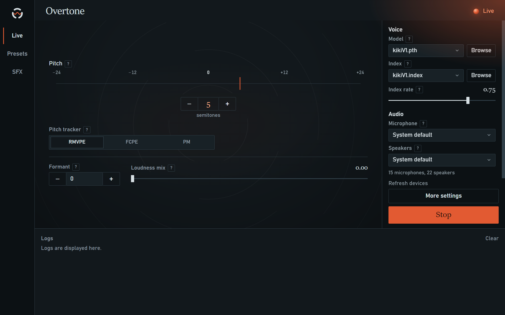
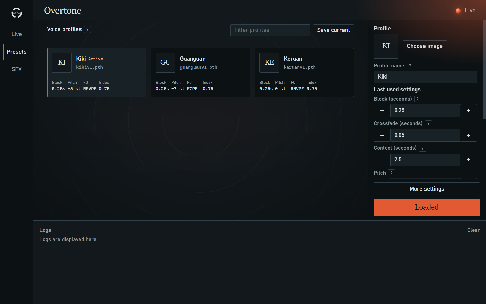
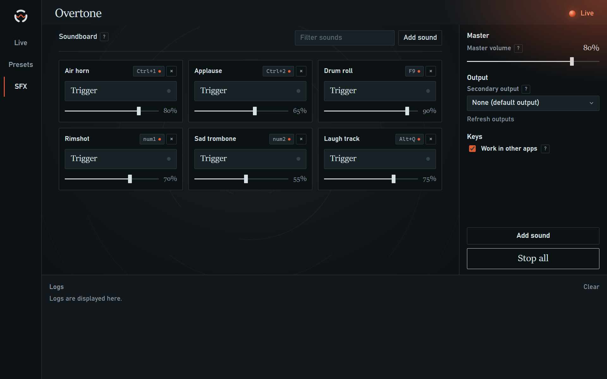

<div align="center">


# Overtone

**Real-time voice conversion for RVC models, from the command line or a desktop app.**

Speak into your microphone and hear the converted voice live, or batch-convert audio files with the same streaming pipeline.

[](https://github.com/mtran05/RVC-clone/actions/workflows/ci.yml)
[](LICENSE)


[Features](#features) ·
[Screenshots](#screenshots) ·
[Quick start](#quick-start) ·
[Usage](#usage) ·
[Documentation](#documentation) ·
[Contributing](CONTRIBUTING.md)

<br />



</div>

---

## Features

- **Live conversion with no seams.** Audio is converted in blocks and crossfaded, so there are no clicks where blocks meet.
- **File conversion** through the same pipeline, so a file sounds exactly like live conversion would.
- **Three pitch trackers:** RMVPE (most accurate), FCPE (lighter) and PM (classic), switchable while live.
- **Pitch and formant shifting**, plus optional FAISS index blending for a closer match to the target voice.
- **Fast on NVIDIA GPUs:** automatic precision selection and CUDA graph replay, with DirectML and CPU fallbacks.
- **Desktop app** with a **Live** page that preloads your voice so going live is near-instant, saved voice **Presets**, and a **Soundboard** whose keys can work while a game has focus.

## Screenshots

The **Live** page is shown at the top: pitch, formant and pitch tracker on the stage, and the voice and audio devices in the side panel. All of them can change while you're live.

<!-- 390 px is the widest two images can be side by side: GitHub's README column
     is about 838 px, and each cell adds 26 px of padding plus borders. Both
     columns stay equal because every caption line is narrower than its image;
     keep it so when editing the captions. -->

| Presets | Soundboard |
| :-----: | :--------: |
|  |  |
| Saved voice profiles. Loading one<br />preloads its model, so Go live<br />starts instantly. | Pads with their own volume and<br />keybinds. A lit dot marks keys<br />that also work in other apps. |

The screenshots use sample voice models. Your own models appear in the same places.

## Requirements

| Component | Version                                                                                   |
| --------- | ----------------------------------------------------------------------------------------- |
| OS        | Windows 10/11 x64 (the CLI also runs on Linux; the desktop app is Windows only)           |
| Python    | 3.12 x64                                                                                  |
| GPU       | NVIDIA GPU with at least 4 GB VRAM and compute capability 5.3 or higher (recommended)     |
| CUDA      | 12.8 wheels for PyTorch (required for RTX 50 series)                                      |
| Node.js   | 22.12 or newer (only needed to build or develop the desktop app)                          |

> [!NOTE]
> Without a supported NVIDIA GPU, Overtone falls back to DirectML (if `torch-directml` is installed) and then to the CPU. CPU inference works for file conversion but is usually too slow for live use.

## Quick start

### 1. Create a virtual environment

Run this from the repository root (Windows PowerShell):

```powershell
python -m venv .venv
.venv\Scripts\activate
```

> [!IMPORTANT]
> The desktop app looks for the interpreter at `.venv\Scripts\python.exe`, so keep the virtual environment at that path.

### 2. Install dependencies

PyTorch is installed separately so `requirements.txt` cannot replace the CUDA build:

```powershell
python -m pip install torch==2.7.1+cu128 torchaudio==2.7.1+cu128 --index-url https://download.pytorch.org/whl/cu128 --extra-index-url https://pypi.org/simple
python -m pip install -r requirements.txt
```

For a different CUDA version or hardware, pick the matching command from [pytorch.org](https://pytorch.org/get-started/locally/).

### 3. Download the base models

HuBERT (content features) and RMVPE (pitch) are required for every conversion:

```powershell
python -m pip install --upgrade huggingface_hub
hf download lj1995/VoiceConversionWebUI --revision main --include "hubert_base/*" --local-dir assets
hf download lj1995/VoiceConversionWebUI rmvpe.pt --revision main --local-dir assets/rmvpe
```

### 4. Add voice models

Place trained RVC voice models and their optional retrieval indexes here:

```
assets/
├── hubert_base/     # downloaded in step 3
├── rmvpe/rmvpe.pt   # downloaded in step 3
├── weights/         # your .pth voice models
├── indices/         # matching .index files (optional)
└── sounds/          # soundboard clips for the desktop app (optional)
```

The `assets/` folder is git-ignored, so models never end up in version control.

## Usage

Convert your microphone live, playing the result through your speakers. Press `Ctrl+C` to stop:

```powershell
python -m inference.realtime --model assets/weights/myvoice.pth --index assets/indices/myvoice.index --live
```

Or convert a file:

```powershell
python -m inference.realtime --model assets/weights/myvoice.pth --index assets/indices/myvoice.index --input voice.wav --output converted.wav
```

The options you'll reach for most:

| Flag                                 | Default | Description                                               |
| ------------------------------------ | ------- | --------------------------------------------------------- |
| `--key`                              | `0`     | Pitch shift in semitones, from −24 to 24                  |
| `--formant`                          | `0`     | Formant shift in semitones                                |
| `--f0`                               | `rmvpe` | Pitch tracker: `rmvpe`, `fcpe` or `pm`                    |
| `--index-rate`                       | `0.75`  | How strongly to blend toward the index, from 0 to 1       |
| `--input-device` / `--output-device` | system  | Device number from `--list-devices`, or part of its name  |
| `--block-time`                       | `0.25`  | Block length in seconds. Lower means less delay.          |

Every option, device selection and file formats are in **[docs/cli.md](docs/cli.md)**.

### Desktop app

The desktop app drives the same converter through a window, with every option available while you're live:

```powershell
cd desktop
npm install
npm start
```

`npm run pack` builds a portable `desktop\dist\Overtone.exe`. Keep it inside the project folder, where it can find `.venv`. See **[docs/desktop.md](docs/desktop.md)** for the Live page, presets and soundboard keys.

## Documentation

| Guide                                            | What's in it                                                                     |
| ------------------------------------------------ | -------------------------------------------------------------------------------- |
| [Command line](docs/cli.md)                      | Every option, choosing audio devices, file conversion, environment variables     |
| [Desktop app](docs/desktop.md)                   | Running and building the app, the status lamp, presets, soundboard keys          |
| [Architecture](docs/architecture.md)             | How conversion works, the desktop worker, what each setting change costs, project layout |
| [Troubleshooting](docs/troubleshooting.md)       | Crackling audio, devices, robotic voice, the app not finding the project         |
| [Contributing](CONTRIBUTING.md)                  | Tests, linting, CI, adding an option, code conventions                           |

## Responsible use

Voice conversion can imitate real people. Only use voice models you have the right to use, get consent before converting someone else's voice, and never use this project to impersonate, deceive or harass anyone.

## Acknowledgements

- [Retrieval-based-Voice-Conversion-WebUI](https://github.com/RVC-Project/Retrieval-based-Voice-Conversion-WebUI): the original RVC project. The synthesizer in `inference/module/` is ported from it.
- [RMVPE](https://github.com/Dream-High/RMVPE) and [TorchFCPE](https://github.com/CNChTu/FCPE) for pitch estimation.
- [HuBERT](https://huggingface.co/lj1995/VoiceConversionWebUI) base model weights hosted by lj1995.
- [FAISS](https://github.com/facebookresearch/faiss), [Praat / Parselmouth](https://github.com/YannickJadoul/Parselmouth) and [python-sounddevice](https://github.com/spatialaudio/python-sounddevice).

## License

Distributed under the MIT License. See [`LICENSE`](LICENSE) for details.
