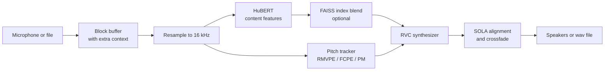
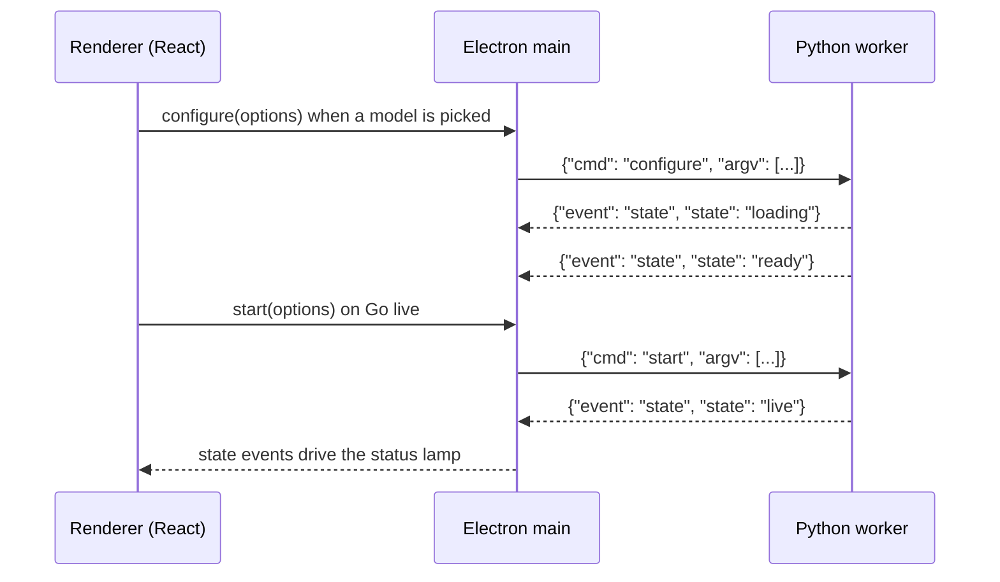

# Architecture

How Overtone turns your voice into another, and how the desktop app keeps that fast.

- [The conversion pipeline](#the-conversion-pipeline)
- [Warm-up](#warm-up)
- [Hardware selection](#hardware-selection)
- [The desktop worker](#the-desktop-worker)
- [What a change costs](#what-a-change-costs)
- [One source of truth for options](#one-source-of-truth-for-options)
- [Project structure](#project-structure)

## The conversion pipeline



1. **Buffering.** Incoming audio is cut into fixed blocks (`--block-time`), each prefixed with a few seconds of earlier audio (`--extra-time`) so the model has context.
2. **Content.** HuBERT turns the 16 kHz audio into features that describe *what* was said, independent of who said it.
3. **Retrieval.** When an index is provided, those features are pulled toward the nearest neighbours from the target voice's training data.
4. **Pitch.** The selected tracker estimates the fundamental frequency, which is shifted by `--key`.
5. **Synthesis.** The RVC synthesizer combines content and pitch into audio in the target voice.
6. **Stitching.** SOLA slides each new block until it best matches the end of the previous one, then crossfades the two to avoid audible seams.

File conversion runs the same blocks and crossfade, one after another, so a file sounds exactly like live conversion would.

## Warm-up

The first block through a fresh model does one-time work: it loads the pitch model and records CUDA graphs, which replay the fixed-shape GPU work of later blocks with less overhead. That first block takes seconds, not milliseconds, and live audio would drop out while it ran.

So before the audio opens, the converter runs silent warm-up blocks, then clears its buffers so the silence leaves no trace. The desktop app also warms up every pitch tracker, so switching between them while live is seamless.

While a stream is open, no new CUDA graph is recorded. Recording one takes about half a second, longer than a block. So a shape the graphs haven't seen, such as a new formant value, runs without a graph at first. That is slower but still well inside the block's time budget, and it gets a graph at the next warm-up.

## Hardware selection

[`inference/device.py`](../inference/device.py) picks the device once per process:

- **CUDA GPU:** at least 4 GB of memory and compute capability 5.3. If there are several, the newest and largest wins. Modern cards run in float16; Pascal (6.1) and GTX 16-series cards stay in float32.
- **DirectML:** used when no CUDA GPU qualifies and `torch-directml` is installed.
- **CPU:** the last resort. Fine for files, usually too slow for live use.

## The desktop worker

The desktop app doesn't start a new Python process each time you go live. Loading torch, HuBERT and a voice takes tens of seconds, so Electron starts one long-running [`python -m inference.worker`](../inference/worker.py) process and keeps it for the whole session.



- **Commands** go to the worker's stdin as one JSON object per line: `configure`, `start`, `stop` and `shutdown`. Their `argv` holds the same flags as the [command line](cli.md#all-options), built by [`desktop/args.js`](../desktop/args.js) and parsed by the CLI's own parser and checks.
- **Events** come back on stdout as JSON lines: state changes and errors. Logs go to stderr, so stray library output can't corrupt the event stream.
- **Batching:** while the worker is busy loading, newer `configure` commands replace older queued ones, and a Stop pressed during loading cancels the start.
- **Shutdown:** closing stdin tells the worker to exit. If Electron crashes, the worker sees its stdin close and exits too, so it never keeps holding the microphone or the GPU.

## What a change costs

Each option in [`opts-spec.json`](../desktop/shared/opts-spec.json) has an `apply` field. The worker reads it to do the least work a change needs while you're live:

| `apply`     | Options                                                                | What happens                                                                 |
| ----------- | ---------------------------------------------------------------------- | ---------------------------------------------------------------------------- |
| `live`      | pitch, formant, pitch tracker, index and index rate, gains, thresholds | Used from the next audio block, with no gap                                  |
| `stream`    | devices, host API, channels, latency, WASAPI, safety buffer            | The audio devices reopen (well under a second); the model stays loaded       |
| `converter` | block, crossfade and context length, sample rate                       | The converter is rebuilt and warmed up (about a second)                      |
| `model`     | the voice model                                                        | The voice reloads (about a second); HuBERT and the pitch models stay loaded  |

A pitch tracker that failed to warm up, for example because its weights are missing, falls back to a `converter` restart instead of loading in the middle of the audio.

## One source of truth for options

Every option is described once, in [`desktop/shared/opts-spec.json`](../desktop/shared/opts-spec.json): its flag, type, default, range, `apply` cost, UI label, tooltip and CLI help. That file feeds:

- the Python argument parser in [`inference/realtime.py`](../inference/realtime.py), and through it the worker;
- the flags [`desktop/args.js`](../desktop/args.js) sends to the worker;
- the renderer's form controls and the **More settings** sheet.

[CONTRIBUTING.md](../CONTRIBUTING.md#adding-an-inference-option) walks through adding one.

## Project structure

```
.
├── inference/                 Python inference package
│   ├── realtime.py            CLI entry point: file conversion, live mode, device listing
│   ├── worker.py              long-running process the desktop app drives over stdin/stdout
│   ├── live.py                audio devices and the live microphone-to-speaker stream
│   ├── converter.py           block buffering, warm-up and SOLA crossfade
│   ├── rtrvc.py               streaming RVC model (HuBERT, index, pitch cache, synthesizer)
│   ├── device.py              GPU and precision selection
│   ├── cuda_graph.py          CUDA graph capture and replay
│   ├── opts.py                loads the shared option spec
│   ├── hubert.py              HuBERT content features
│   ├── rmvpe.py               RMVPE pitch estimation
│   ├── fcpe.py                FCPE pitch estimation (DirectML-compatible)
│   └── module/                synthesizer network, ported from upstream RVC
├── desktop/                   Electron desktop app
│   ├── main.js                app lifecycle and window
│   ├── preload.js             the only API exposed to the page
│   ├── args.js                turns the page's options into flags for the worker
│   ├── repo.js                locates the project folder from the exe
│   ├── main/                  project locator, the Python worker, global hotkeys, IPC handlers
│   ├── shared/opts-spec.json  single source of truth for every option
│   ├── tests/                 main-process tests
│   └── renderer/              React + TypeScript UI (Vite)
│       └── src/
│           ├── components/    one .tsx and one .module.css per component
│           ├── hooks/         useLog, useDevices, useDismiss
│           ├── lib/           bridge types, option specs, presets, status, hotkeys
│           ├── pages/         Live, Presets and SFX pages
│           └── styles/        global tokens and shared control styles
├── tests/                     Python tests (pytest), with the model and audio devices faked
├── docs/                      these guides and the README screenshots
├── .github/workflows/ci.yml   CI: ruff and pytest, plus the desktop verify suite
├── pyproject.toml             ruff and pytest settings
├── requirements.txt
├── requirements-dev.txt       pytest and ruff
└── LICENSE
```
